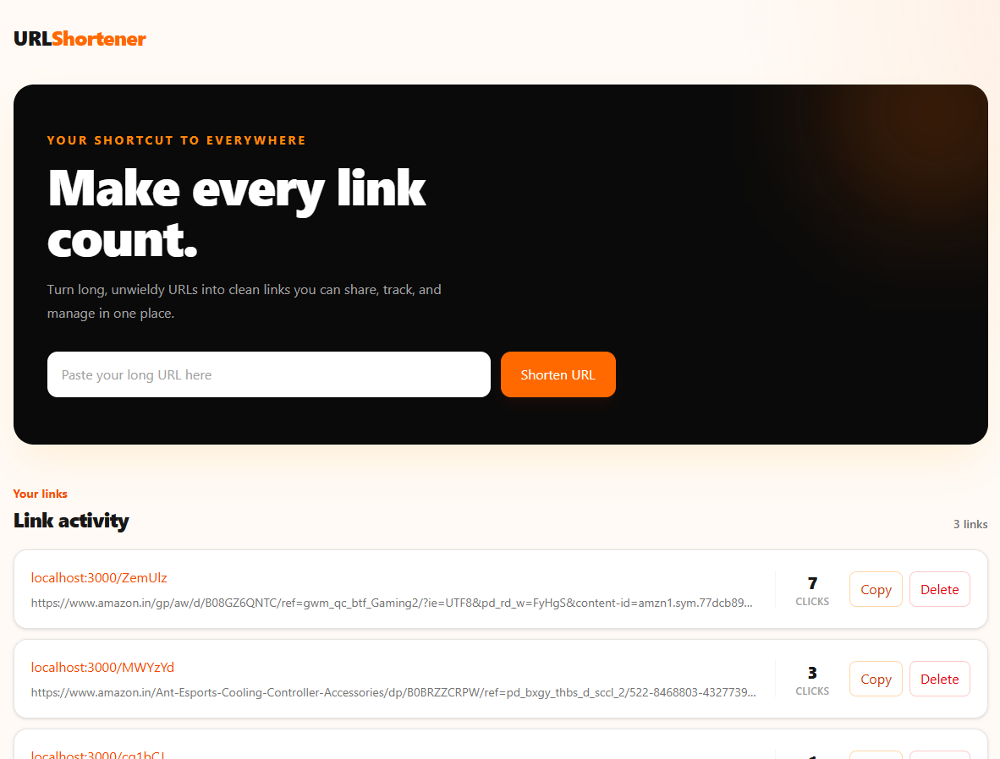

# URL Shortener

A simple MERN stack application for converting long URLs into short, shareable links with click tracking and redirect support.

## Preview


## Key Features

- Shorten long URLs into unique 6-character codes
- Redirect short links to their original destinations
- View all saved shortened links
- Delete unwanted links
- Track click counts for each shortened URL

## Tech Stack

- MongoDB
- Express.js
- React
- Node.js
- Mongoose for database models
- Vite for the frontend development server

## Project Structure

```text
URL Shortener/
├── backend/
│   ├── src/
│   │   ├── app/
│   │   ├── config/
│   │   ├── controllers/
│   │   ├── models/
│   │   ├── routes/
│   │   ├── utils/
│   │   └── server.js
│   ├── package.json
│   └── .env
├── frontend/
│   ├── src/
│   ├── public/
│   ├── package.json
│   ├── vite.config.js
│   └── index.html
└── README.md
```

## API Endpoints

- `POST /api/url` — Create a short URL from a long URL
- `GET /api/url` — Get all shortened URLs
- `DELETE /api/url/:id` — Delete a shortened URL
- `GET /:code` — Redirect a short code to the original URL

## Basic Setup and Run

1. Clone the repository:
   ```bash
   git clone https://github.com/Anirudh-Negii/url-shortener.git
   cd url-shortener
   ```
2. Install backend dependencies:
   ```bash
   cd backend
   npm install
   ```
3. Create a `.env` file in `backend/` with:
   ```env
   MONGO_URI=your_mongodb_connection_string
   PORT=3000
   ```
4. Start the backend:
   ```bash
   npm run dev
   ```
5. Install frontend dependencies:
   ```bash
   cd ../frontend
   npm install
   ```
6. Start the frontend:
   ```bash
   npm run dev
   ```

The app is typically available at:
- Frontend: `http://localhost:5173`
- Backend API: `http://localhost:3000`
